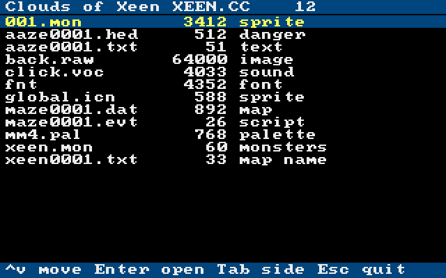
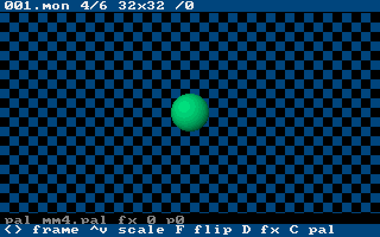

# OpenXeen

An open-source engine for **Might and Magic IV: Clouds of Xeen**, **Might and
Magic V: Darkside of Xeen** (together *World of Xeen*) and *Swords of Xeen*,
written in Rust. It runs on the data files of your own copy of the game, on
the desktop, inside RetroArch and in the browser.

This is a rewrite of [OpenXeen](https://github.com/busyDuckman/OpenXeen), the
Java project started by Dr Warren Creemers in 2016 and left unfinished in
2017. It keeps its goal (a faithful engine that can also be improved and
modded) and restarts on a new foundation.



## Status

**Milestone 0 — foundation (done).** Every data format is read *and written*,
the renderer matches the reference byte for byte, and all three frontends run.
You can browse every graphic, map, script, font, palette and sound of your
archives. The game itself (exploration, events, party, combat) is the subject
of the next milestones; see [the roadmap](docs/ROADMAP.md).

| Part | State |
|---|---|
| CC archives, name hashing, index obfuscation | read + write, identical to ScummVM |
| Sprites (every opcode), palettes, fonts | read + write; renderer identical to ScummVM on 12 000 random draws |
| Maps (`.dat`), danger data (`.hed`), monster and animation tables | read + write; real samples round-trip byte for byte |
| Placements (`.mob`), scripts (`.evt`), texts | read + write, following the engine's own reading rules |
| VOC sound | read, played by the mixer |
| Adlib music (`.m`) | milestone 1 |
| Desktop (SDL2), libretro core, browser (WebAssembly) | running (demo + asset browser) |

## Getting the game data

OpenXeen contains no game data. World of Xeen (with Swords of Xeen) is sold by
GOG in the *Might and Magic 6-pack*. You need the archives from the install
folder:

| File | Used for |
|---|---|
| `XEEN.CC` | Clouds of Xeen |
| `DARK.CC` | Darkside of Xeen |
| `INTRO.CC` | intro, shared pictures (optional) |
| `SWRD.CC` | Swords of Xeen |

The non-interactive demos that circulate are not enough.

## Running

### Desktop

```sh
cargo run --release -p openxeen-sdl -- --data /path/to/xeen
```

Without `--data` the current directory is used when it holds the archives;
otherwise a demo of the renderer runs. You can also drop the game folder onto
the window. Keys: arrows, Enter, Esc, Tab (switch archive), F11 fullscreen.
Needs the SDL2 development package on Linux (`libsdl2-dev`); on Windows and
macOS `--features bundled` builds SDL2 from source.

### RetroArch (libretro core)

```sh
cargo build --release -p openxeen-libretro
retroarch -L target/release/libopenxeen_libretro.so /path/to/xeen/XEEN.CC
```

Load any archive of the game folder as content; the others are found next to
it. Started without content, the core runs the demo. Copy
`crates/libretro/openxeen_libretro.info` into RetroArch's `info` folder to get
the proper name in menus.

For ARM handhelds (RK3326 and similar) CI builds `aarch64` and `armv7` cores
against glibc 2.17, so they load on old and new firmwares alike:

```sh
pip install cargo-zigbuild
cargo zigbuild --release -p openxeen-libretro --target aarch64-unknown-linux-gnu.2.17
```

`scripts/libretro_smoke.c` is a 100-line libretro frontend that loads a built
core with `dlopen`, runs the demo and a content file, and checks pictures and
audio; it also runs under `qemu-user` for ARM builds. The x86_64, aarch64 and
armv7 cores produce bit-identical frames.

### Browser

```sh
scripts/build-web.sh
python3 -m http.server -d dist/web 8000     # then open http://localhost:8000
```

Pick or drop the archives on the page. They are read by the page only and
never uploaded. *Sample data* opens a small archive generated by OpenXeen.



### xeentool

```sh
cargo run -p openxeen-tool -- help
xeentool list XEEN.CC                       # every entry, with recovered names
xeentool extract XEEN.CC out/               # decoded files
xeentool pack out/ MOD.CC                   # and back
xeentool sprite XEEN.CC 001.mon goblin.png  # all frames on one sheet
xeentool evt DARK.CC maze0001.evt           # script listing with its texts
xeentool screenshot shot.png --data dir --keys enter,right
```

## Design in one page

* **`openxeen-formats`**: parsers and writers for every original format.
  No I/O, no unsafe code, no panics on bad input.
* **`openxeen-engine`**: platform-neutral core. Game logic is written as
  `async` code and advanced one frame per host call, so the blocking loops of
  the original design ("wait for a key", "fade for 20 ticks") port directly
  and still run under libretro and in the browser, which forbid blocking.
* **Frontends**: SDL2 desktop, libretro core, WebAssembly page. Each is a thin
  layer that moves input, pixels and samples.
* **Faithful first, improvements as options.** The rules follow the original
  (ScummVM's reimplementation is the reference); enhancements such as a wider
  3D view, monster respawn or less save-scumming will be switches, off by
  default.

Details: [docs/ARCHITECTURE.md](docs/ARCHITECTURE.md).

## Testing

```sh
cargo test --workspace                       # unit and integration tests
oracle/build.sh                              # builds the ScummVM oracle (C++)
OPENXEEN_ORACLE=target/oracle/xeen_oracle \
OPENXEEN_REF_DIR=target/scummvm-ref/devtools/create_mm/files/xeen \
  cargo test --workspace                     # + differential and sample tests
node scripts/test-web.cjs dist/web /tmp/synth/xeen.cc   # browser end to end
```

The **oracle** compiles code extracted verbatim from a pinned ScummVM revision
and feeds it the same random inputs as the Rust port; outputs must be
identical. The **reference samples** are real-format files from ScummVM's
tools, parsed and re-serialised byte for byte. None of them is stored in this
repository.

## Legal

OpenXeen is free software under the **GNU GPL version 3 or later**
([LICENSE](LICENSE)). It ports logic from ScummVM (GPL-3.0-or-later) and
supersedes the original OpenXeen (LGPL-2.0, which permits relicensing under
the GPL, §3). Might and Magic is a trademark of its owner. OpenXeen is not
affiliated with the trademark owner, GOG or the ScummVM project. See
[CREDITS.md](CREDITS.md).
